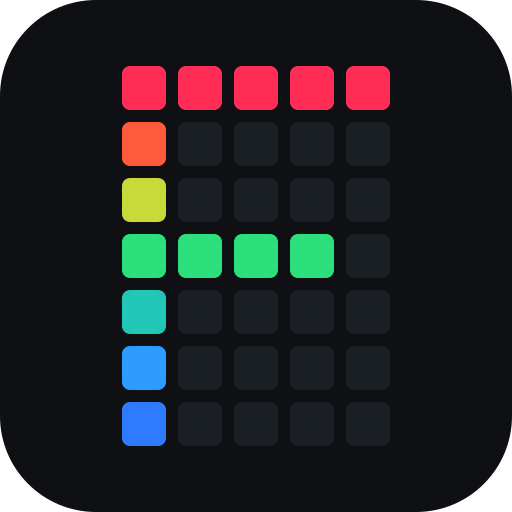

# FocusRGB



A desktop RGB controller under active development with an Avalonia UI and .NET 10 background core.
The first executable targets Windows; shared code remains portable for future platforms.
**Early implementation:** slices 00–11 provide the contract, solution scaffold, validated
profile configuration, a runnable selected-item UI, named application groups, an ordered
in-memory mapping editor with insertion drag/drop, the portable selection engine, and a persistent
profile editor. Profiles can be created, edited, duplicated, or safely removed; Default remains
protected. The Windows app now starts asynchronously, persists manual selection, minimizes to a
tray icon, and saves again before tray Quit or OS shutdown. The Settings page persists close
behavior, start-minimized, theme, and diagnostic-logging preferences, with versioned migration,
last-known-good recovery, and a
metadata-only diagnostics export. Raw host/plugin logs stay local and are omitted from exports
because they may contain credentials. The app hosts explicitly enabled local process plugins
through the packaged 1.0 SDK and coordinates desired, applied, fallback, pending, ownership, and
consent-gated recovery state. Windows process/focus observation now exists behind the platform
boundary; application-group persistence and runtime detector wiring are still pending. See
[Core configuration](src/FocusRgb.Core/README.md).

The app will select lighting profiles manually or from named application groups using a
user-ordered priority list: the top eligible row wins. Rules can remain active while an app is
running or only while it has focus. Each profile owns exactly one effect and one layout.
First launch uses manual mode; subsequent launches restore the saved state.
The seeded profiles are protected Default plus Programming (VS Code/Visual Studio), Movie
(PotPlayer/Stremio), and Music (Media Player/Spotify). In automatic mode, no eligible mapping
returns to Default.

The main `Home` tab always shows the Manual/Automatic mode control. Manual mode shows profile
selection and current state; Automatic mode replaces that body with the ordered mapping editor.
The `Profiles` tab saves profile changes under `%LOCALAPPDATA%\FocusRGB`, supports optional draft
preview, and rejects invalid fallback cycles or removal while mappings/fallbacks still refer to a
profile.

## Implementation roadmap

1. Add external-application automation, SignalRGB, games, and local-model MCP control on the
   implemented plugin coordination boundary.
2. Build standalone native effects, LED placement layouts, screen ambience, and output plugins.

SignalRGB owns rendering and its existing layout while its integration is active, including
its WLED output. A separate WLED plugin supports native operation. Application mappings are
customizable; the core and UI have no dependency on either provider's implementation.

Native layouts will support a 2D placement canvas, stacked device groups, and device exclusion.
Game effects can combine canvas animation, semantic zones, and direct key/LED mappings.
The optional Windows-only `FocusRgb.Mcp.exe` adapter is off by default and can be enabled only from
the app's Settings page. It exposes read tools through a local authenticated pipe; settings and
selection commands require explicit, single-use approval in the app.

## Start here

- [Project board](https://github.com/orgs/FocusRGB/projects/1): current delivery status and planning.
- [Archived-document index](https://github.com/FocusRGB/FocusRGB/issues/83): links to the slice and
  architecture records in Issues #26–#55 and Milestones #1–#5.
- [Plugin protocol](sdk/spec/plugin-protocol.md): normative language-neutral process-plugin 1.2
  transport, lifecycle, messages, and compatibility policy.

Changes reach `develop` through reviewed pull requests. Planning, workflow history, slice status,
and architecture decisions are maintained in GitHub Issues, Milestones, and the project board.

## Repository conventions

The main repository owns the protocol, schemas, conformance kit, host, and raw fake plugin.
Official SDKs and their templates live in
[`FocusRGB-Plugin-SDK`](https://github.com/FocusRGB/FocusRGB-Plugin-SDK). Production integrations
live in independent repositories named `FocusRGB-Plugin-<Name>` and consume a published SDK
version; they are not Git submodules or app project references.

The independent
[`FocusRGB-Plugin-SignalRGB`](https://github.com/FocusRGB/FocusRGB-Plugin-SignalRGB) repository
owns the SignalRGB provider implementation and maintained research. Application projects live under [src/](src/README.md); the shared screen colour test remains under `tools/`.

## Project structure

```text
FocusRGB.slnx
sdk/
  spec/                        normative protocol and manifest schemas
  conformance/                 language-neutral protocol runner
  examples/python-plugin/      no-SDK language-neutral example
src/
  FocusRgb.Core/               net10.0, host protocol, profiles, selection, and persistence
  FocusRgb.Platform.Windows/   net10.0-windows, focus/process detection
  FocusRgb.App/                net10.0-windows, Avalonia shell (FocusRGB.exe)
  FocusRgb.LocalMcp/           private authenticated named-pipe transport
  FocusRgb.Mcp/                official-SDK stdio MCP adapter (FocusRgb.Mcp.exe)
tests/
  FocusRgb.App.Tests/          xUnit; UI-facing preview-state tests
  FocusRgb.Core.Tests/         xUnit; dependency-boundary and core tests
  FocusRgb.FakePlugin/         executable plugin protocol fixture
tools/                         screen colour test
build/                         generated output (git-ignored)
```

## Build and test

Game rules use cached executable names, including while discovery is offline. Common crash
handlers and installers never trigger game rules. A name shared by several catalog games cannot
identify a specific game and is ignored for exact-game rules. Refresh games on the Games tab to
request updated catalogs from running discovery plugins; malformed entries are skipped individually.
`games.last-known-good.json` protects cached and manual game entries during recovery.

Requires the .NET SDK pinned in `global.json` (10.0.401 or a later 10.0 feature band).

```powershell
dotnet build FocusRGB.slnx -c Release
dotnet test --solution FocusRGB.slnx -c Release
.\build\artifacts\bin\FocusRgb.App\release\FocusRGB.exe
```

Package versions are pinned centrally in `Directory.Packages.props`. CI runs the same build
and tests for every pull request and for pushes to `develop` and `main`.

Generated builds, packages, reports, caches, and tool artifacts belong under the Git-ignored
`build/` directory. Maintained source stays outside it. Generated Graphify data lives at
`build/graphify-out/` and is optional for development.

## Plugin configuration

An installed plugin opts into the generic settings window by placing
`focusrgb-settings.schema.json` beside its manifest. Schema version 1 declares 1–64 flat fields
with an `id`, `displayName`, `type` (`string`, `integer`, `number`, `boolean`, or `json`) and
`default`; schema/field `description`, `minimum`, and `maximum` are optional. FocusRGB validates and stores the
opaque values in `%LOCALAPPDATA%\FocusRGB\plugin-data\<plugin-id>\settings.json`, then restarts a
running plugin. The plugin receives that directory through `FOCUSRGB_PLUGIN_DATA_DIRECTORY`.

## License

[MIT](LICENSE).
